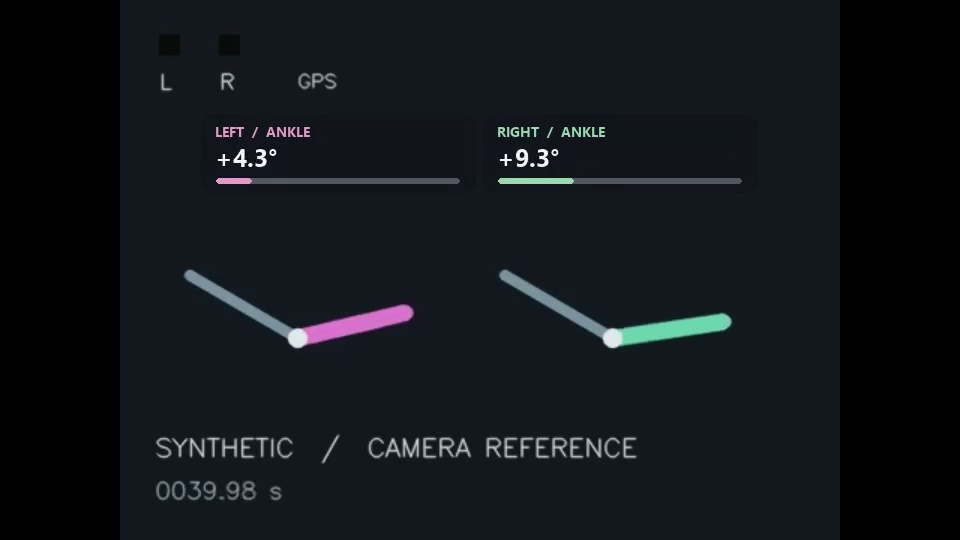

# KartPedal 🏎️

See when each foot moves through a corner. KartPedal takes the raw six-axis recordings from a shoe and a shin, estimates their relative angle and puts that trace alongside speed and lap distance in LapViz Studio. A transparent ankle strip carries the same measurements into a video edit.

**The main export is a LapViz file.** The optional DJI clip supplies a clock. A filmed LED flash identifies the same instant in the logger and the video. The clip stays separate, so you can open it beside the telemetry in Studio or use it in a later edit. [How the flashes are matched](docs/CALIBRATION_AND_SYNC.md)

**Pre-hardware release · 27 November 2026.** The Windows app, both firmware builds and the synthetic recording-to-video workflow have been tested in software. The parts have yet to arrive. The first physical milestone is one bare controller on USB.

[Watch the 9.3 s edit](measurement/artifacts/final/review.mp4) · [Open the demo telemetry](measurement/artifacts/final/KartPedal.lvz) · [Get the transparent strip](measurement/artifacts/final/ankle-strip.mov)

## Run it on Windows

1. Double-click [Start KartPedal.cmd](Start%20KartPedal.cmd). Select **Load synthetic demo**, then **Process and export LVZ**.
2. When **LVZ ready** appears, select **Show finished export folder**. Each run gets its own directory under `measurement/user-data/exports/`.
3. In [LapViz Studio](https://lapviz.studio/), choose **Open a file** and select **KartPedal.lvz**. Select both laps and add **Right Ankle Excursion**. Compare the traces at the same distance.
4. For the video example, put the [4:3 source](measurement/artifacts/outing/synthetic-camera.mp4) on Resolve track V1 and the [full-length strip](measurement/artifacts/final/ankle-strip.mov) on V2, aligned at their first frame. Link them before trimming. [Video walkthrough](docs/LAPVIZ_AND_VIDEO.md)

## Where to go next

| When | Open |
|---|---|
| First launch or a fresh PC | [Quick start and installation](docs/QUICK_START.md) |
| The parcel arrives | [First hardware test, wiring and side-specific flashing](docs/HARDWARE_FIRST_TEST.md) |
| Packing for practice or processing a card | [Track and desktop checklist](docs/USER_GUIDE.md) |
| Choosing calibration windows or matching markers | [Calibration and synchronization, with worked examples](docs/CALIBRATION_AND_SYNC.md) |
| Reading angle, timing, gaps or a lap comparison | [Telemetry, LapViz and the Resolve edit](docs/LAPVIZ_AND_VIDEO.md) |
| A diagnostic fails or a recording is incomplete | [Troubleshooting and recovery](docs/TROUBLESHOOTING.md) |
| Reproducing the engineering checks | [Architecture](docs/ARCHITECTURE.md) · [Release results and open gates](docs/TEST_RESULTS.md) |

The angle is heel-supported ankle excursion in degrees. A driver can change effort while holding the same pose. Brake force, pedal travel and throttle position remain outside this measurement.

The [original V18 build manual](KartPedal_Master_Engineering_Report_V18_2026-11-26.html) preserves the parts ledger, diagrams and physical acceptance criteria. Use the guides above for the compiled firmware and current software.
