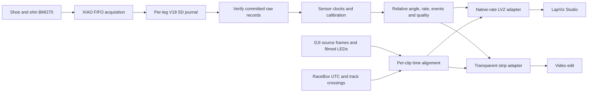

# How a sensor sample reaches LapViz

| Boundary | Implementation and contract |
|---|---|
| Capture | Each XIAO runs two independent BMI270 FIFOs at 100 Hz, ±16 g and ±2000°/s. Acquisition and SD writing have separate tasks. A short BOOT press timestamps LED edges. Controlled stop drains and closes before SAFE_OFF. [Sketch](../firmware/KartPedal/) |
| Storage | Each sensor epoch has a 48-byte header and packed 30-byte little-endian `<QII6hH` records. Preserve MCU µs, sequence, raw/inferred sensor tick, six signed counts and flags. Header and block CRC-32 cover their specified bytes. The synced journal binds contiguous block offsets and event watermarks. [Shared firmware format](../firmware/KartPedal/v18_format.h) · [Golden bytes](../software-v18/synthetic-two-laps/golden/imu_shoe_e000000.bin) |
| Ingest | The streaming verifier stages verified prefixes using bounded reads, validates boot, side, epoch, ordering, flags and close totals, and reports issues. Processing checks issues before estimation. Raw inputs retain SHA-256 fingerprints. [Streaming decoder](../measurement/verify-stream.mjs) · [Legacy recovery core](../software-v18/kartpedal-v18-core.mjs) |
| Measurement | Fit 24-bit sensor ticks per epoch to MCU read brackets. Map axes to a common anatomical frame and estimate relative rotation from calibrated shoe and shin dynamics. Interpolate across consecutive valid samples up to 30 ms. Gaps, epochs, unstable pose and off-axis motion can suppress angle and events. [Estimator and event detector](../measurement/engine.py) |
| Timing | Each logger has its own affine fit to decoded clip presentation times. GPS has an independent UTC-elapsed fit. Held-out anchors validate each fit. Logger-only mode has a local time origin. [Markers](../measurement/markers.py) · [Camera frames](../measurement/video.py) · [RaceBox](../measurement/racebox.py) |
| Publication to disk | The pipeline uses a temporary directory and publishes a complete run into a fresh destination. Native LVZ retains separate foot and GPS sample groups. The video adapter consumes the same motion and time grid. [Pipeline](../measurement/pipeline.py) · [LVZ writer](../measurement/export_lvz.py) · [Strip renderer](../measurement/overlay.py) |
| Verification | The simulator writes raw sensor recordings and the real journal. Truth is stored separately and used for scoring. Re-journalling changed gyro bytes changes estimated motion. The held-out mounting tests the same model with different mounting/noise. [Simulator](../measurement/raw_sim.py) · [Acceptance scorer](../measurement/acceptance.py) |

The desktop orchestrates import, calibration, alignment and export locally. Studio handles lap analysis. VBO remains an experiment because its tested round trip populated invalid angles. The earliest caption/CSV examples remain available in the [format experiment archive](../software-v18/integration-evidence/RESULTS.md).
