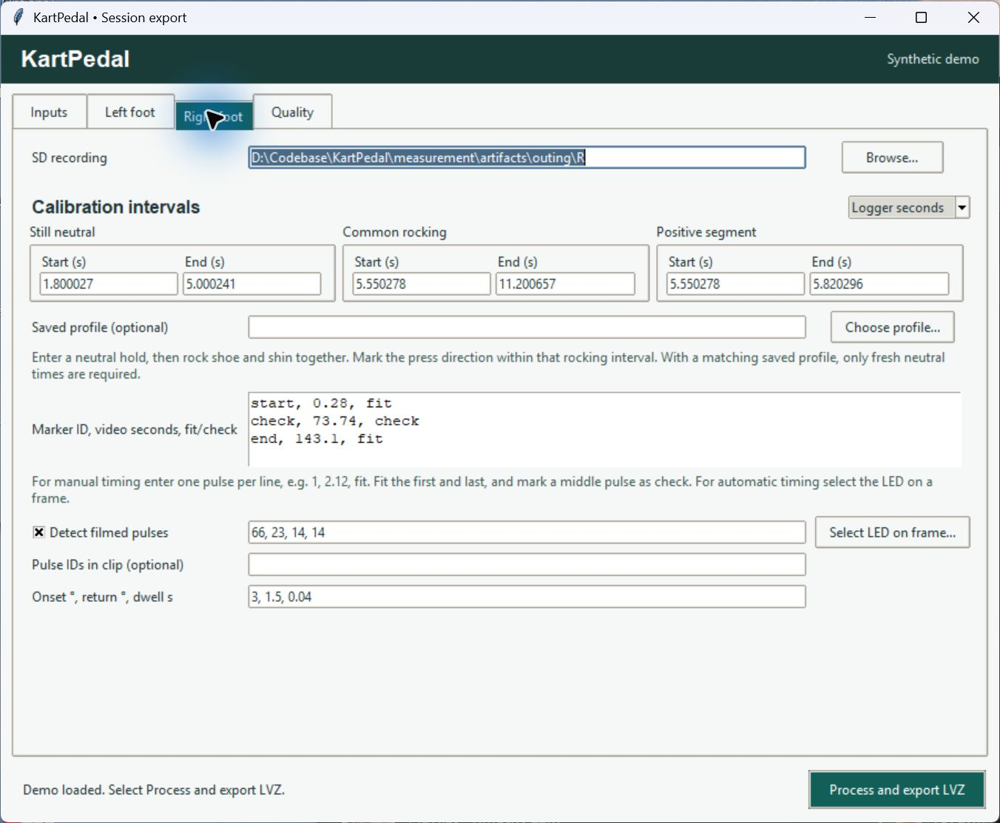
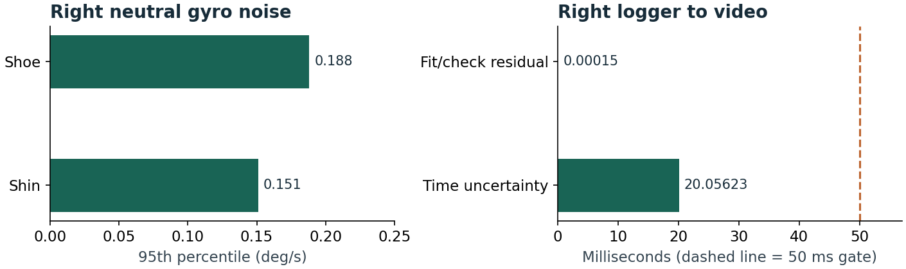

# Calibration and synchronization

**Calibration** establishes what a positive ankle movement means for one physical mounting. **Synchronization** establishes when that movement appears in one video. A clean angle trace can still be paired with the wrong frame. Check both before comparing feet or laps.

## Calibrate one side

1. **Start DJI and identify the foot.** Film a stationary side view of shoe and shin, heel supported, toes up in neutral. Hold still for several seconds. The estimator needs at least 100 valid 100 Hz samples from each IMU.
2. Keeping the ankle angle fixed, **rock shoe and shin together** about a fixed ankle pivot in the forward/back plane. Include several smooth reversals. Note one portion moving toward the press direction. This identifies the hinge axis and its sign. The rocking interval needs ≥100 valid samples and the positive portion ≥8.
3. Perform separate, visible ankle presses and returns. Confirm positive excursion in the expected direction. Watch for pod rocking, suit motion or the lace capsule twisting. A positive calibration fit alone cannot establish a mechanically stable mount.
4. On the matching foot tab, enter each start and end in its labelled pair. Choose **Video seconds** for elapsed time since the clip’s first presentation frame or **Logger seconds** for MCU seconds. In the supplied right logger, neutral runs from 1.800 to 5.000 s, common rocking from 5.550 to 11.201 s, and its positive segment from 5.550 to 5.820 s.
5. On the same device and confirmed identical mounting, select a saved profile and enter a **fresh 1–60 s neutral interval**. Device, side, configuration and neutral orientation must agree. Remove the saved profile and perform full calibration after a refit, changed sign or failed neutral check.

**Reading the example.** The right shoe’s neutral gyro noise was 0.188°/s at the 95th percentile, the shin’s 0.151°/s. Both pivot fits were accepted. The fresh-calibration stillness test rejects noise above 2°/s or mean gravity magnitude more than 0.08 g from 1 g. A rejected interval calls for checking the video, sensor identity and mount. [Right calibration profile](../measurement/artifacts/final/R-profile.json)

## Match each independent clock

| Clock | What you do | What to inspect |
|---|---|---|
| Shoe/shin → their logger | Automatic from FIFO sensor ticks, read brackets and reset epochs | `sensor_clocks` lists anchor count, µs per tick and maximum fit residual per sensor/epoch. |
| Each logger → DJI clip | Film three complete short BOOT pulses while stationary. Use start/end for the fit and reserve a middle pulse as an independent check. | First lit frame in **elapsed clip seconds**. Check residual, frame period, uncertainty and supported time range. |
| RaceBox → DJI clip | Match at least three **independently** identifiable crossings or verified common-time events spanning the clip. Use two to fit and one inside them to check. | GPS elapsed seconds from the first CSV record, video elapsed seconds and role. Check track direction and lap numbers. |

**Automatic LED detection.** On the foot tab choose **Select LED on frame**, scrub to a lit frame and drag tightly around that side’s LED. Supply the filmed IDs in observed order if only a subset appears. The detector needs darkness before and after a roughly 700 ms pulse. Avoid a whole-frame brightness change in the rectangle.

**Manual correction.** Clear the automatic pulse option. Enter the actual logged ID, first-lit elapsed frame time and role on each line. The synthetic right recording uses these literal IDs and times. Real firmware records numbered marker IDs.

~~~text
start, 0.28, fit
check, 73.74, check
end, 143.10, fit
~~~

For the demo, the held-out right marker agreed to about **0.00015 ms**. The camera has **20 ms** frames, and the combined estimated timing uncertainty was **20.06 ms**. The Quality table shows 20.1 ms uncertainty. The processing log shows a marker residual below 0.01 ms. A residual above **50 ms**, a missing check or a check outside the anchors prevents an accepted camera fit. Each source clip needs its own timing evidence. [Full clock values](../measurement/artifacts/final/quality.json)

**RaceBox import.** Request extended custom CSV with timezone-qualified UTC time, GPS position, speed and lap counter. Select the speed unit actually exported. **Inspect GPS lap crossings** lists candidate times, which still need an identifiable match on video. Leave anchor pairs empty to validate the CSV separately and export foot data without synchronized speed or laps. Ankle onset and GPS deceleration are different physical events.

## Physical acceptance after delivery

Film ≥20 press/return cycles per side. Score event crossings against visible motion with frame uncertainty. V18 targets ≥95% detection, p95 timing error ≤50 ms where measurable, and angle error and drift <10% of usable range. On a rigid object, shared rotations should produce no confident relative events. Repeat with fixed-pose effort changes, bracing and cable flex, then remove and refit ×3. Inspect video for slip or false motion. [Synthetic results and open physical gates](TEST_RESULTS.md)
