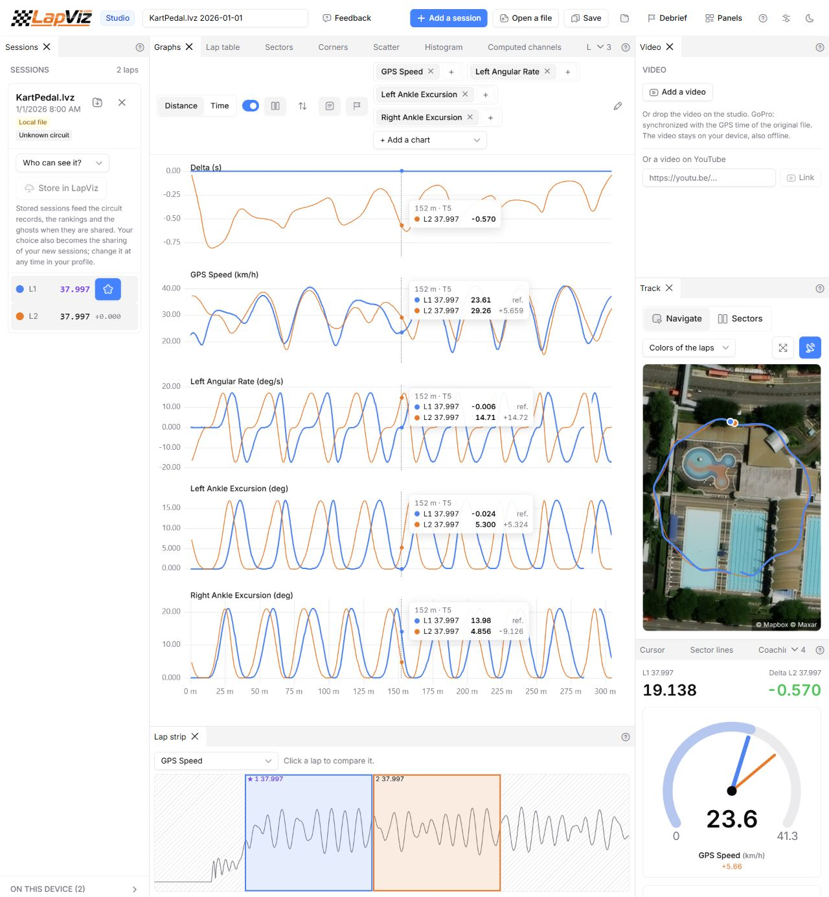
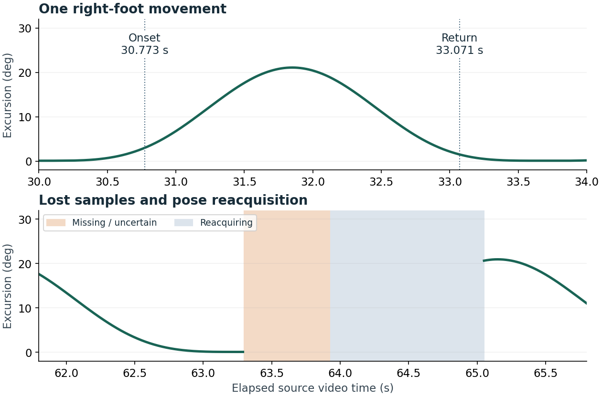

# 📈 Read a lap and edit a video

## Compare the same corner in LapViz Studio

KartPedal’s LVZ contains telemetry. If you want to see the drive alongside it, drop the matching original clip on **Studio’s video panel**. With the full camera-aligned export and the full original clip, start with zero player offset and check a known flash. Studio’s manual offset adjusts playback against the loaded telemetry. KartPedal’s start/end fit aligns each logger clock and corrects its drift before export. Rendering the transparent strip is a separate optional step. [Studio video-panel trial](../software-v18/integration-evidence/RESULTS.md)

1. Choose **Open a file** in [LapViz Studio](https://lapviz.studio/) and select the [demo LVZ](../measurement/artifacts/final/KartPedal.lvz) or your own original KartPedal export. Local analysis needs no session upload.
2. Select both laps. Add **Left Ankle Excursion** and **Right Ankle Excursion**. Use the distance axis to compare the same corner in the same direction. The demo contains two laps of 37.997 s. On one trace at 152 m the left foot reads −0.02° and the right 14.0°.
3. Compare movement timing against speed within valid intervals. Add **Valid** or **Quality Code** when a trace disappears. Use **Dashboard** for the local gauges. Keep the original LVZ for later analysis. Studio’s tested re-export reduced the 100 Hz foot traces to 25 Hz.

## Read the channels

| LVZ channel | Unit / rate | Interpretation |
|---|---|---|
| Left / Right **Ankle Excursion** | ° at 100 Hz | Signed shoe rotation relative to the shin, referenced to calibrated neutral. |
| Left / Right **Angular Rate** | °/s at 100 Hz | Signed speed of the relative motion. |
| Left / Right **Valid** | 1 or 0, step | Use numbers only at 1. Invalid angle and rate cells are empty. An absent side has no channels. |
| Left / Right **Quality Code** | 0–3, step | 0 valid, 1 missing or timing uncertain, 2 reacquiring pose, 3 excessive off-axis movement. These are reason codes, not a probability. |
| **Latitude**, **Longitude**, **GPS Speed**, **Distance** | degrees, degrees, km/h, m | Independent RaceBox samples inside the aligned window. Demo rate ≈25 Hz. Distance accumulates along the GPS path. A long GPS outage makes the subsequent cumulative distance unknown. |

At **30.773 s** the estimated right angle first crossed the 3° onset threshold. It remained above threshold long enough to confirm at **30.820 s**. On return through 1.5°, the corresponding times were **33.071 s** and **33.120 s**. Use `crossing_s` for timing comparisons and retain `confirmed_s` to show the decision delay. A gap interrupts the dwell. The second graph shows the missing measurements followed by pose reacquisition. A blank cannot support a claim that the driver released the pedal. [Right-side events](../measurement/artifacts/final/R-events.json)

## Put the transparent foot strip in Resolve

**Try the supplied media first.** The [source clip](../measurement/artifacts/outing/synthetic-camera.mp4) and [strip](../measurement/artifacts/final/ankle-strip.mov) each span 144 s. The [9.3 s review](../measurement/artifacts/final/review.mp4) shows five selected windows already cut together.

1. In a test timeline, import the two full-length files. Use a 16:9 timeline at 50 fps for this example. Put the source on **V1**, strip on **V2**. Line up their first frames. Leave clip speed at 100%.
2. Frame the original 4:3 footage on **V1**. Start with fit, then zoom or adjust vertical framing to taste. Position the 576 × 88 strip independently on the final canvas in **V2**. Its alpha should reveal the footage around the gauges. If the strip comes in enlarged, set its input scaling to retain its original size or adjust the Inspector scale.
3. Select both clips and **Link Clips**. Enable linked selection and cut both tracks together, or group them into one compound clip before trimming. Ripple out pits, outlap and inlap together. For independently edited tracks, preserve source in/out times for each retained range.
4. Render and play the **exported file**. Check first, withheld middle and end markers against source time. Also inspect a moving foot and a known invalid interval. For the supplied edit, left marker rises appear at 0.12, 6.34 and 8.20 s. Right rises appear at 0.28, 6.54 and 8.40 s. The demo preserves the whole 4:3 frame inside 16:9 so its marker patches remain visible. [Cut map](../measurement/artifacts/final/edit-map.json)

For a new video, use the original clip associated with that export. The renderer samples its 50 fps strip on elapsed source time. Keep real-time playback on other timeline rates and check the actual presentation frames. Each split DJI clip needs its own validated time map.

### Generate a strip for a new export

From PowerShell in the project root, enter the full folder shown by **Show finished export folder**. Choose a new output filename if one already exists.

~~~powershell
$run = Read-Host "Completed KartPedal export directory"
.\.venv\Scripts\python.exe -B measurement/overlay.py $run "$run/ankle-strip.mov"
~~~

The output is ProRes 4444 with alpha. The bars span 0–30° for display and the numbers show signed degrees. The strip displays **Unavailable** during invalid or absent data.

### Which video paths have been exercised?

| Path | Evidence |
|---|---|
| Local two-foot strip → edited MP4 | Tested with FFmpeg. The complete strip decodes with alpha, all 465 edited frames decode, and six filmed pulses survived five cuts within one frame. |
| Hosted LapViz overlay editor | Tested with the public example’s Steering Angle widget. The exported PNG and 55.48 s VP9 WebM contain transparent and opaque pixels. The custom two-foot KartPedal session stayed off hosted rankings. Hosted two-foot rendering is unverified. [Native example and alpha evidence](../measurement/evidence/lapviz-video.json) |
| Resolve | The media and timing are verified locally. An actual import, compositing and render in the installed Resolve version is still unverified. No personal project was opened. A real DJI edit is a first-outing gate. |

[Recovery for gaps and split clips](TROUBLESHOOTING.md) · [Home](../README.md)
