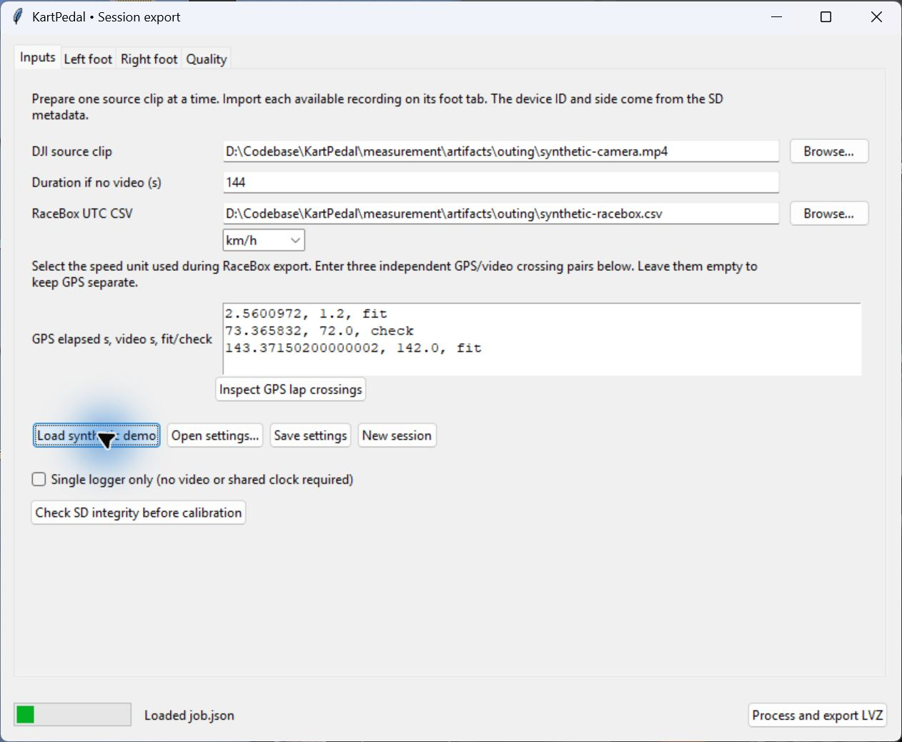

# 🚀 First export on Windows

**On this PC, double-click [Start KartPedal.cmd](../Start%20KartPedal.cmd).** The launcher selects the project’s Python environment. The demo already includes both SD trees, a camera clip, a RaceBox-format file and filmed marker locations.

1. Under **Inputs**, click **Load synthetic demo**. The video and CSV paths appear. Leave the supplied calibration and marker settings in place.
2. Click **Process and export LVZ**. Follow the progress on **Quality**. The first run can take longer while Python compiles the estimator.
3. Look for **LVZ ready** and select **Show finished export folder**. Expect 14,157 valid left and 14,078 valid right samples out of 14,400 rows in this fixture. Its intentional gap tests how missing data travels through the workflow.
4. Open **KartPedal.lvz** using **Open a file** in [LapViz Studio](https://lapviz.studio/). For the video result, [play the prepared edit](../measurement/artifacts/final/review.mp4). To make a strip from a new export, follow [LapViz and video](LAPVIZ_AND_VIDEO.md).

## Files you will see

| File in the new export | What to open it for |
|---|---|
| `KartPedal.lvz` | The original native-rate session for Studio |
| `quality.json` | Input fingerprints, integrity, sensor clocks, marker fits and quality counts |
| `L-events.json`, `R-events.json` | Event crossing time and time confirmed |
| `L-profile.json`, `R-profile.json` | Device, neutral calibration, sensor axes and biases |
| `settings.json`, `source-frames.csv` | Reopen the run settings and look up elapsed source frame times |
| `L-motion.f32`, `R-motion.f32` | Estimated angle, rate and validity reason used by the video and LVZ writers |

Only recorded sides get side files. The app saves each export under `measurement/user-data/exports/<run>/`. The separately rendered demonstration and its cut map are in the [prepared media folder](../measurement/artifacts/final/).

## Install on another Windows PC

Keep the project folders together. Use 64-bit Python 3.12 with Tcl/Tk and Node.js on PATH. The release was exercised with Python 3.12.7 and Node 24.22.3. Python supplies the desktop and estimator. Node verifies the binary journal. The Python requirements include the FFmpeg used for video. [Python for Windows](https://www.python.org/downloads/windows/) · [Node.js](https://nodejs.org/en/download)

From PowerShell in the KartPedal folder, run once on a new installation (package downloads require internet).

~~~powershell
python --version
node --version
python -m venv .venv
.\.venv\Scripts\python.exe -m pip install -r measurement\requirements.txt
.\.venv\Scripts\python.exe -B -c "import tkinter,numpy,scipy,numba,PIL,cv2,imageio_ffmpeg; print(imageio_ffmpeg.get_ffmpeg_version())"
~~~

Launch the app again. [If startup fails](TROUBLESHOOTING.md)

## Optional terminal equivalent

Run this from the project root. Choose a fresh destination under KartPedal for every run. The example generates a unique folder, which you can also use as the input for rendering a strip.

~~~powershell
$run = "measurement/user-data/exports/demo-$(Get-Date -Format yyyyMMdd-HHmmss-fff)"
.\.venv\Scripts\python.exe -B measurement/pipeline.py measurement/artifacts/outing/job.json $run
~~~

[Back to KartPedal](../README.md)
