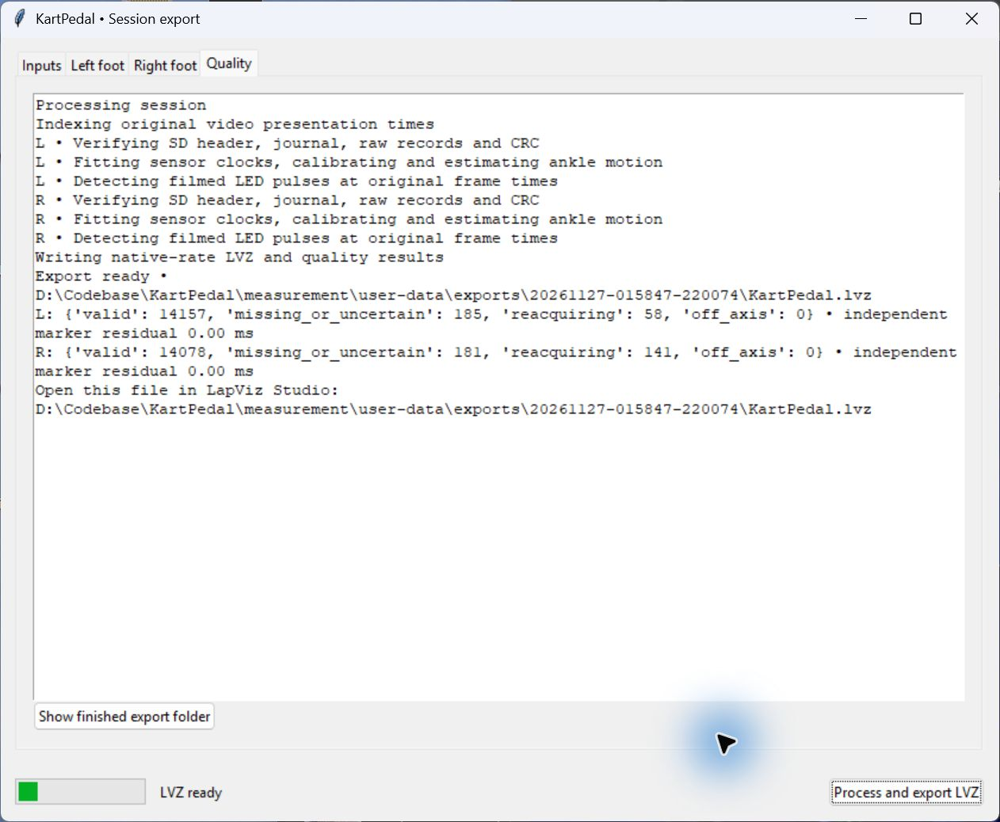

# 🏁 One outing, from bag to video

Use this checklist after the first leg passes its [bench and stationary fit gates](HARDWARE_FIRST_TEST.md). Start with the side that qualified. A second side can join later.

## Night before and at the kart

- [ ] Charge the qualified, inspected cell off-body in maintenance. Check the DJI and RaceBox, their storage, the qualified FAT32 card, cable retention and available runtime.
- [ ] Insert the card and connect the shoe loom with the pod powered off. Label the outing, track direction, kart and side. Record any refit or changed clothing layer.
- [ ] Put the shoe sensor on the marked forefoot position and the pod on the marked lateral shin. Secure both lace contacts and shin restraints. **Keep straps clear of LED, BOOT and latch.** Sit, steer, press, release and check entry/exit. Stop for interference, discomfort or a loose lead.
- [ ] USB disconnected, BOOT released, latch on. Look for the RECORD heartbeat after the startup grace. Start RaceBox and confirm it is recording. **Start DJI before the filmed calibration cycles.** Include the foot, shin and reference movement in the calibration view.
- [ ] While stationary, film a complete short-press marker for each logger with its identity visible or recorded in your notes. Record neutral, common rocking, positive-direction interval and controlled press/return. Note the clip and times. [Calibration walkthrough](CALIBRATION_AND_SYNC.md)

## During a stint and between sessions

- [ ] Drive with the loggers recording locally. Leave the controls alone while moving. At a safe stationary break, film a separate middle marker for each side. Capture identifiable track crossings for independent GPS alignment.
- [ ] Before stopping DJI, film the complete end pulses. Hold BOOT ≥2 s to stop each logger. Steady LED permits latch-off. Triple flash permits latch-off with a potentially incomplete recording. Stop DJI and RaceBox and note their session names.
- [ ] For another stint, cold-start a **new boot folder per device**, start the recorders, repeat reference movements and capture its own anchors. Mark device, boot, side, clip and refit together. Treat a DJI file split as a separate source clip.

## At the laptop

1. **Copy.** With the pod off and USB unplugged, copy each whole `device-id/boot-uuid/` directory, original DJI clips and original RaceBox export into an outing folder. Retain filenames and separate stints. Work from copies.
2. **Select.** Launch [KartPedal](../Start%20KartPedal.cmd), choose **New session** and browse to each available side’s folder containing `meta.json`. Select one original clip on **Inputs**. **Check SD integrity before calibration** prints verified records, known losses and clipping per stream.
3. **Calibrate and align.** Enter the observed windows and LED evidence on each foot tab. Enter independently observed GPS crossings if available. Review the units and **Save settings**. [Worked example](CALIBRATION_AND_SYNC.md)
4. **Process.** Click **Process and export LVZ**. In **Quality**, inspect missing and reacquiring intervals, clock residuals and warnings. Open `quality.json` for per-sensor fits, uncertainty and failure details. A successful export can contain unusable intervals.
5. **Compare and edit.** Open the original LVZ in Studio. Compare same-direction laps at matched distance within valid windows. Put the transparent strip over the source in Resolve. Link the layers for pit, outlap and inlap cuts. Inspect the exported video at start, middle and end. [Analysis and edit instructions](LAPVIZ_AND_VIDEO.md)

## What carries over

| Saved locally under `measurement/user-data/` | Reuse |
|---|---|
| `sessions/` | **Save settings** writes a dated JSON. **Open settings** restores paths, windows and anchor choices. Verify them against the new outing. |
| `profiles/` and `devices/` | Successful exports save each calibration and register its device and configuration. Select the matching profile on the foot tab and collect fresh neutral evidence. Recalibrate after a changed mount. |
| `exports/` | Each successful run has a new folder. Its `settings.json` also reopens in the app. Preserve the native LVZ and QC together. |

Missing a marker, leg, clip or RaceBox file? [Choose a recovery path](TROUBLESHOOTING.md).
